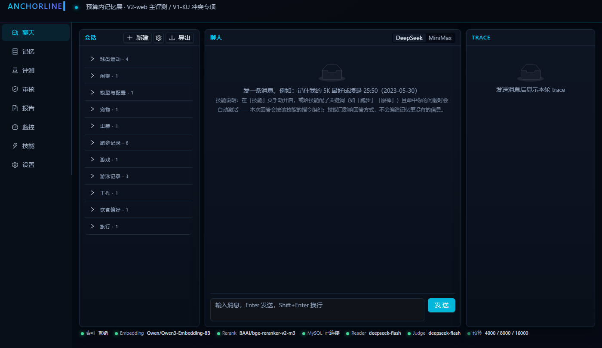
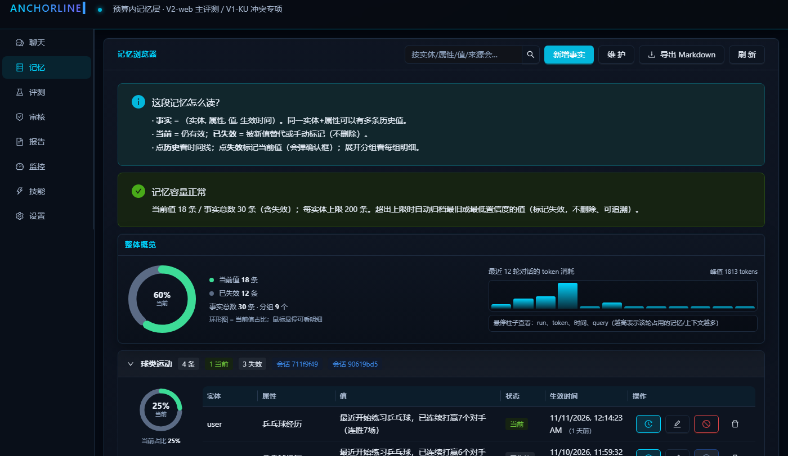
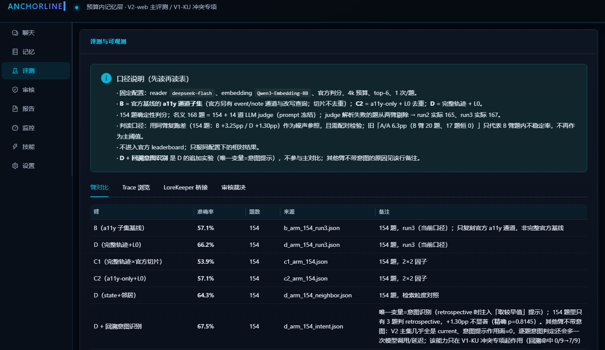
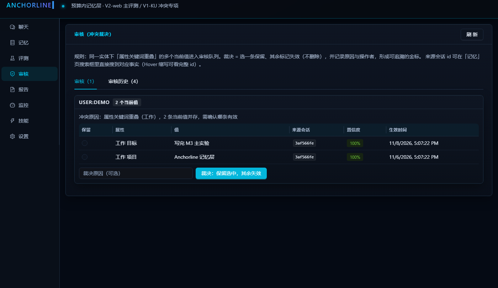
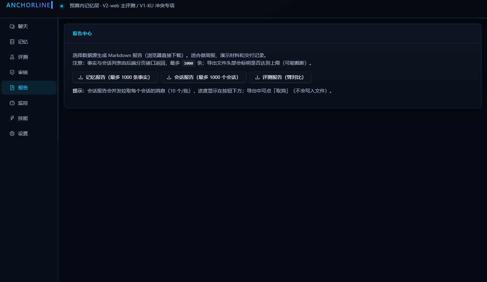
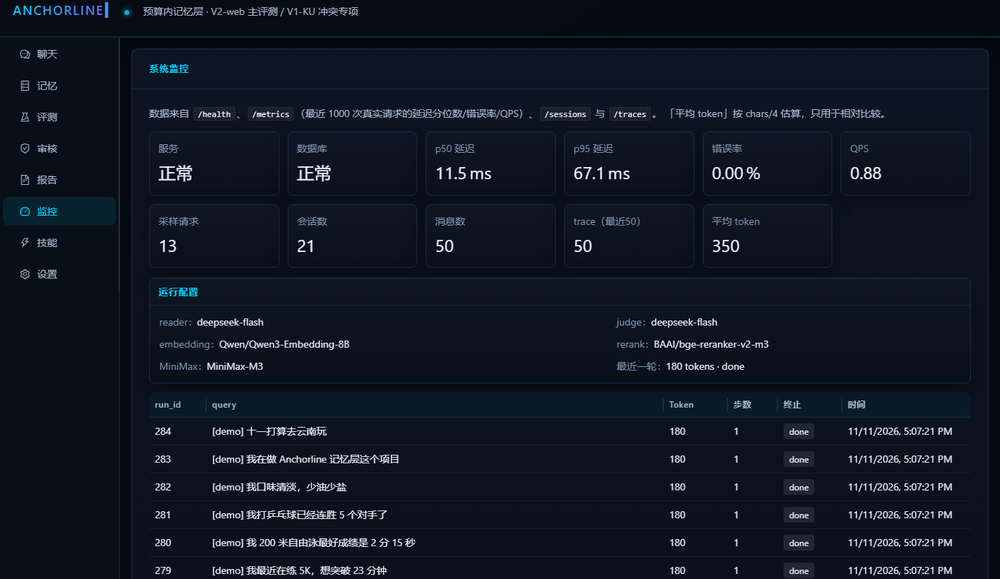
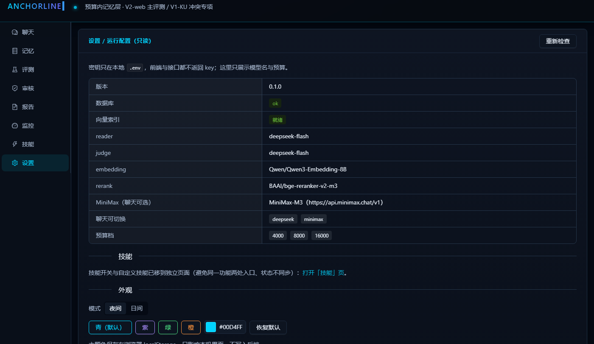

# Anchorline

在**固定 token 预算**下，把多轮对话 / Agent 轨迹压成可回答、可追溯的记忆，并用公开基准回答：**在同样预算下，记忆层相对无记忆、官方 RAG、全量历史，是否真的更好。**

不是「再做一个 RAG」，也不是「又一个聊天机器人」。**可复现、可防守的记忆工程**，不是研究前沿。

## 两个基准（能力面不重叠，互不合并）

| 基准 | 角色 | 分母 |
|---|---|---|
| **LongMemEval-V2 web 子集** | 主评测（环境状态 / 动态跟踪 / 流程 / 陷阱 / 前提） | **名义 168**（154 确定性 + 14 judge；judge 解析失败的题从两臂剔除 → run2 **165** / run3 **167**） |
| **LongMemEval-S knowledge-update** | 冲突专项（过期事实 / 冲突裁决 / 回溯意图） | **72 可判**（1a 63 / 1b 9）；1c 的 6 道是 78 题中**被剔除的拒答变体**，不在 72 内（见 `reports/ku72_build.md`） |

> 168 与 72 都是「该阶段的冻结口径」，不是不可变的最终分母；改口径必须写进文档。

## 与 LoreKeeper 的定位边界

- **Anchorline = 会话/轨迹的记忆层**：事实级（entity / attribute / value），管冲突、回溯、预算。
- **LoreKeeper = 游戏 wiki 的知识库**：chunk / 页面级检索问答。
- 两者的桥接只复用 **检索组件**（BM25 / 向量 / RRF / rerank）在 LoreKeeper 数据集上做对照实验（见 `reports/lorekeeper_bridge.md`），**不是把两个项目合并**。
- 聊天里的 `memory_search` 只查 Anchorline 的 facts；对 LoreKeeper 知识库的检索是 `kb_search`（**已接入聊天工具与 MCP**；`LOREKEEPER_ENABLED=false` 可关闭）。

## 技术栈（已锁定）

- Python **3.13** 单环境；FastAPI + Pydantic + SQLAlchemy 2 + Alembic
- **MySQL 8**（事实 / 会话 / trace / eval_runs / 审核裁决）+ **LanceDB**（向量）+ BM25；向量不进 MySQL
- **LangGraph StateGraph**（不是 LangChain 全家桶；不写 `AgentExecutor` 壳）
- 原生 **function calling** + MCP（`memory_search` / `memory_write` / `memory_forget`）
- React 19 + TypeScript + Vite + Ant Design 5 + SSE

## 目录

```text
src/anchorline/            # 记忆层（L0/L1/L2/L3）、检索（hybrid/facts_index）、图（chat/workflows）、API、MCP
frontend/                  # React 前端（聊天/记忆/评测/审核/报告/监控/会话管理/设置）
migrations/                # Alembic（0001 初始 → 0014：session.topic / trace.recalls / review_decisions / 表注释 / scoring_mode / 技能开关与绑定 / 自定义技能等）
scripts/                   # 评测、索引构建、demo、桥接实验、数据清理
reports/                   # 29 份评测/审计/整改报告（项目最核心的证据资产）
tests/                     # pytest（152 项）
docs/                      # 协议、许可、ADR、评测结果、桥接报告
dataset/                   # 数据与核验产物（大文件不入库）
```

## 界面截图

> 截图中的会话、记忆与 trace 均来自测试数据（非真实用户数据，已获授权公开）。
> `scripts/make_screenshots.py` 直接对运行中的实例截图，**不做脱敏**——只有在实例里全是测试数据时才可提交截图。

### 聊天（用户右 / 模型左、主题分组、技能提示）



### 记忆（容量提示、当前/失效、分组）



### 评测（臂对比 + A/A 噪声底 + LoreKeeper 桥接）



### 审核（冲突裁决金标）



### 报告中心（记忆/会话/评测 Markdown 导出）



### 监控（延迟 / 错误率 / trace）



### 设置（主题色 / 日夜模式）



## 当前状态

- **M0a/M0b 完成**：G1 15/15 自洽（k=0）；V1-KU 72 题标注完成（63/9/6）
- **M1 完成**：L0/L1/L2/L3、事实存储（supersedes + 容量归档）、LangGraph 聊天（真实 tool calling）、MCP 三工具、FastAPI、Alembic
- **M2 前端完成**：聊天（会话主题分组/召回明细）、记忆（主题分组/环形图/删除）、评测（臂对比/Trace/LoreKeeper 桥接）、审核（冲突裁决金标）、报告、监控、会话管理、设置（主题色/日夜）
- **M3 评测（同 reader/embedding/判分/4k 预算）**：B 53.9% / C2 57.1% / D 64.9%（154 题，**run2 口径**；B/D 同批、C2 单批；D vs B **p=0.0115**，精确符号翻转）；168 题 run2 B 53.3% vs D 63.6%（p=0.0186）、run3 B 56.3% vs D 64.7%（**p=0.0541 边缘**）；重复运行单题翻转 ~12%，154 上 D>B 两次都显著 → `reports/stability_runs.md`；报告数字由 `scripts/verify_reported_numbers.py` 校验
- **M3 2×2 因子**：B（a11y×官方切片）/ C2（a11y×L0+L3）/ C1（完整轨迹×官方切片）/ D（完整轨迹×L0+L3），配对检验 → `reports/m3_2x2.md`
- **LoreKeeper 桥接实验**：48 题页面级召回——纯向量 R@1 0.8542；chunk 级 RRF 单用有害（0.7917）、**RRF+rerank 0.8958（+4.17pp）**；**页面级重排 0.9167**；chunk 级自动 gold 与换向量口径见 `reports/lorekeeper_bridge.md`

## 常见问题

- **前端能打开但接口全 500？** 先确认 MySQL 在跑（`run_all.py` 会预检；失败会直接退出并给提示）。
- **`kb_search` 总是空？** 需要 `LOREKEEPER_ENABLED=true` 且 `LOREKEEPER_LANCE_DIR` 指向 LoreKeeper 的 LanceDB 目录；未配置时工具返回空是预期行为。
- **开了 `API_TOKEN` 后页面 401？** 在「设置」页填入同一个 token（只存 localStorage）。
- **报告数字和 JSON 产物对不上？** 跑 `python scripts/verify_reported_numbers.py`（CI 也用它）。
- **记忆页首次进入慢？** 分组默认只展开前 2 组（懒渲染）；展开更多组会按需渲染。

## API Token 鉴权（可选）

> 定位：**后端的门禁密码**（共享密钥），不是用户账号系统。默认关闭；本地自用不用管。

**它保护什么**：设置 `API_TOKEN` 后，除 `/health`、`/docs`、`/openapi.json`、`/redoc` 外，
所有 API 都要求请求头 `X-API-Token: <token>`（也接受 `Authorization: Bearer <token>`），否则 401。
前端在「设置」页填同一个 token 后，会把请求自动带上该头（只存浏览器 localStorage）。

### 启用步骤

```powershell
# 1) 生成一串随机密码（这就是"项目密码"）
.venv\Scripts\python.exe -c "import secrets; print(secrets.token_urlsafe(24))"

# 2) 写进项目根 .env（不要提交）
#    API_TOKEN=<上一步的输出>

# 3) 无需重启：中间件每次请求都会重新读 .env，改完立即生效（如果你用 run_all 起的服务，也建议重启一次确认）
.venv\Scripts\python.exe run_all.py
```

然后打开「设置」页 → API Token → 填入同一串 → 保存 → 刷新。

### 验证

```powershell
curl.exe -i http://127.0.0.1:8000/skills
# → 401（缺少 token）
curl.exe -H "X-API-Token: <token>" http://127.0.0.1:8000/skills
# → 200
curl.exe http://127.0.0.1:8000/health
# → 200（health 永远免鉴权，方便探活）
```

### 典型场景：局域网给同事演示

1. 设好 `API_TOKEN` 并重启；
2. 前端对外监听：`cd frontend; npm run dev -- --host 0.0.0.0`（并在防火墙放行 5173）；
3. 同事打开 `http://<你的局域网IP>:5173`：页面能打开，但数据加载 401；
4. 把 token 发给同事 → 他在「设置」页填入 → 刷新即正常；
5. 演完把 `.env` 里的 `API_TOKEN` 换成新串（或删掉）→ 重启 → 旧 token 立即失效。

### 边界与注意

- 一个 token 通行所有请求：没有账号、多用户或细粒度权限；
- token 明文存储（`.env` + 浏览器 localStorage），**`.env` 已在 `.gitignore`，不要提交**；
- 暴露公网时请放在 **HTTPS 反向代理**后面，否则 token 明文过网；
- 换浏览器/清缓存后需重新在设置页填写；
- 不是加密；**限流是进程内的**（聊天/生成约 30 次/分钟；多进程/多副本部署时限额按副本数放大，重启清零）——它只是"能不能调用 API"的开关与轻量护栏。

## 快速开始

```powershell
# 0) 依赖（Python 3.13）
python -m venv .venv
.venv\Scripts\python.exe -m pip install -e ".[dev]"

# 1) 配置（模板，不含真实 key）
Copy-Item .env.example .env   # 填 MySQL 与 provider key

# 2) 数据库（MySQL 8 运行中）
.venv\Scripts\python.exe -m alembic upgrade head

# 3) 一键启动前后端（仿 lorekeeper run_all.py；Ctrl+C 同时停止）
.venv\Scripts\python.exe run_all.py
#    只起后端：run_all.py --only server
#    只起前端：run_all.py --only client

# 或分别启动：
# $env:PYTHONPATH='src'; .venv\Scripts\python.exe -m uvicorn anchorline.api.main:app --host 127.0.0.1 --port 8000
# cd frontend; npm run dev
```

## Docker 部署

```powershell
# 1) 准备 .env（从 .env.example 复制并填 provider key；MySQL 用 compose 内的库）
Copy-Item .env.example .env

# 2) 启动 MySQL + API + 前端
docker compose up -d --build

# 3) 访问
#   前端  http://127.0.0.1:8080
#   API   http://127.0.0.1:8000/health
```

说明：`dataset/` 不入库——**评测/索引脚本需要先准备 `dataset/`**，否则会明确报错退出（不再静默写全 0 报告）；容器默认不含评测数据；要做评测/索引构建，取消 `docker-compose.yml` 里 dataset 挂载的注释。

## B 臂口径（重要）

- **B ≈ 官方基线的 a11y 通道子集**：官方 baseline 还有 event/note 通道、controller 生成的改写查询与动作序列/截图；本项目只复刻 a11y 通道（见 dataset/v2/official_repo/）。
- **根因是「检索单元粒度」不一致，不是字符上限**：B/C1 的索引单元是 **3-state 拼接**（median 49,341 / 39,998 字符，p10 仍 >22k），D 是**单 state**（median 702 字符）→ 4k 预算下 B/C1 的 top-6 **没有一条能完整入预算**（必然 top-1 截断 + 5 条丢弃），而 D 的 92.7% 装得下。所以「B vs D」在注入完整性上不是同预算对照。
- **按 `预算 ÷ top_k ≈ 2666` 封顶经实测不采用**：重建索引后 B 从 **57.14% 降到 43.51%**（配对差 −13.64pp，精确符号翻转 **p=0.0011**，39/154 题变化）。结论与证据见 `docs/b_arm_slice_cap_experiment.md`；默认封顶改为**预算字符数（16000）**，可用 `ANCHORLINE_INDEX_SLICE_CAP` 覆盖。
- 因此 **B 的绝对准确率不代表官方基线全貌**，只用于本项目内部同预算对照（B vs C1/C2/D）。
- **历史产物（b/c2/d/hybrid/intent）是旧代码路径生成的**：截断标记、system 合并、Similarity 标签是后续修复；重跑会与 `reports/` 中的旧数字不同（未重跑，因为需要 provider key 与索引重建）。

## 核心能力

| 能力 | 说明 | 命令/入口 |
|---|---|---|
| 记忆层 | L0 跨 state 行去重 → L1 观测摘要 → L2 事实（supersedes）→ L3 预算组装 | `src/anchorline/memory/` |
| **技能（可开关）** | 独立「技能」页：内置 4 个技能（跑步教练 / 饮食规划 / 知识库问答 / 记忆整理）+ 用户自定义；支持开关、模板、按描述自动生成、绑定记忆实体、关键词自动激活。聊天时把启用技能指令拼进 system prompt——指令影响**回答方式与写入建议**（memory_hygiene 会引导 supersedes_id，倒挂/链指向防护见 memory/store.py）；**评测走独立 prompt 组装链路，不受技能开关影响**（技能只占产品侧 system prompt 预算） |
| **混合检索** | jieba + BM25Plus + 向量（Qwen3-Embedding/LanceDB）+ RRF + BGE rerank；失败自动回退。**注意：在 V2 轨迹长文本上实测 −10.4pp（p=0.0195，相对纯向量，见 `reports/d_arm_154_hybrid.md`）——主评测因此保持纯向量；产品侧目前只用于短事实文本（**该场景尚未做对照实验，不能视为已验证**） | `memory_search` 工具 / `POST /memory/search` |
| **知识库问答（可选）** | `kb_search` 工具查 LoreKeeper 三库 wiki（sr/ys/zzz，页面级重排），与事实记忆分工；关掉 `LOREKEEPER_ENABLED` 即禁用 | 聊天 / MCP |
| **容量保护** | 每实体当前值上限（默认 200，`MEMORY_MAX_CURRENT_PER_ENTITY`），超限自动归档最旧/低置信度（标记失效） | `GET /memory/capacity` |
| **召回可解释** | 每条召回的 BM25/向量/RRF/rerank 分数写入 trace，前端 Trace 面板展示 | `trace.recalls` |
| **冲突裁决** | 审核页：选一条保留、其余失效、记录原因 → `review_decisions` 金标 | `POST /review/decisions` |
| 可追溯 | 事实不物理删除；历史、失效时间、裁决记录可查 | `GET /memory/facts/{id}/history` |
| 会话主题 | 模型生成 topic（如“跑步/游泳/乒乓球”），前端按主题分组 | `sessions.topic` |
| 报告导出 | 记忆 / 会话 / 评测 Markdown 导出 | 前端「报告」页 |
| 审核裁决金标 | 审核页裁决（保留 + 失效 + 原因）写入 `review_decisions`，评测页「审核裁决」Tab 展示 | `POST /review/decisions` |

## 实验与复现

```powershell
# 单元测试
.venv\Scripts\python.exe -m pytest -q

# 一键 demo：写入 → 更新（旧值自动失效）→ 混合检索 → 容量 → 清理
.venv\Scripts\python.exe scripts\demo.py

# 全量重建事实向量索引（写入时已同步，脚本用于初始化/修复）
.venv\Scripts\python.exe scripts\rebuild_facts_index.py

# V2 评测（B / C2 / D / 168）
.venv\Scripts\python.exe scripts\aa_pilot.py --limit 154 --n 1 --out data\eval\b_arm_154_run2.json
.venv\Scripts\python.exe scripts\eval_c2_arm.py --limit 154
.venv\Scripts\python.exe scripts\eval_d_arm.py --limit 154 --n 1 --table v2_web_states_d --b-ref data\eval\b_arm_154_run2.json --out data\eval\d_arm_154_run2.json
.venv\Scripts\python.exe scripts\eval_168_judge.py

# LoreKeeper 数据集桥接（页面级 Recall/MRR）
.venv\Scripts\python.exe scripts\lorekeeper_bridge.py --k 5
.venv\Scripts\python.exe scripts\lorekeeper_bridge.py --mode page --k 5

# chunk 级（自动 gold）与换向量口径
.venv\Scripts\python.exe scripts\lorekeeper_chunk_gold.py --by bm25
.venv\Scripts\python.exe scripts\lorekeeper_chunk_eval.py --k 5 --gold data\eval\lorekeeper_chunk_gold_bm25.json

# M2 记忆质量（V1 72 题）与 L2 事实抽取
.venv\Scripts\python.exe scripts\eval_m2_quality.py
.venv\Scripts\python.exe scripts\eval_l2_extraction.py
```

## 工程与运维

| 项 | 用法 |
|---|---|
| 一键启动 | `.venv\Scripts\python.exe run_all.py`（`--only server\|client`、`--port`） |
| Lint | `.venv\Scripts\python.exe -m ruff check src tests scripts run_all.py examples` |
| 测试 | `.venv\Scripts\python.exe -m pytest -q`；CI 里带 `--cov=src/anchorline` |
| e2e | `cd frontend; npm run e2e`（本地真实模型用例：`$env:REAL_E2E='1'; npm run e2e`） |
| 备份/恢复 | `scripts\backup_db.ps1` / `scripts\restore_db.ps1 -File <sql>` |
| MCP 客户端示例 | `.venv\Scripts\python.exe examples\mcp_client.py` |
| 日志 | 默认文本；`LOG_FORMAT=json` 输出结构化 JSON，`LOG_LEVEL=DEBUG` 调级别 |
| 流式 | 默认伪流式（答案生成后逐块）；`STREAM_MODE=real` 时真 token 流（多一次模型调用） |
| 依赖锁 | `requirements.lock`（`pip freeze`） |

## 数据与许可边界

- V2 = Apache-2.0（轨迹原文可入库，保留 LICENSE + NOTICE）；**不下载 5.92 GB 轨迹截图包**
- V1-S 的 MIT 只覆盖 benchmark 自身；**session 原文不入库**
- PerLTQA / engram-eval / LoCoMo 等非商用数据不入库
- **API Key 只经 `.env` 读取**，不入库、不进日志、不进对话；`.env.example` 只有占位符
